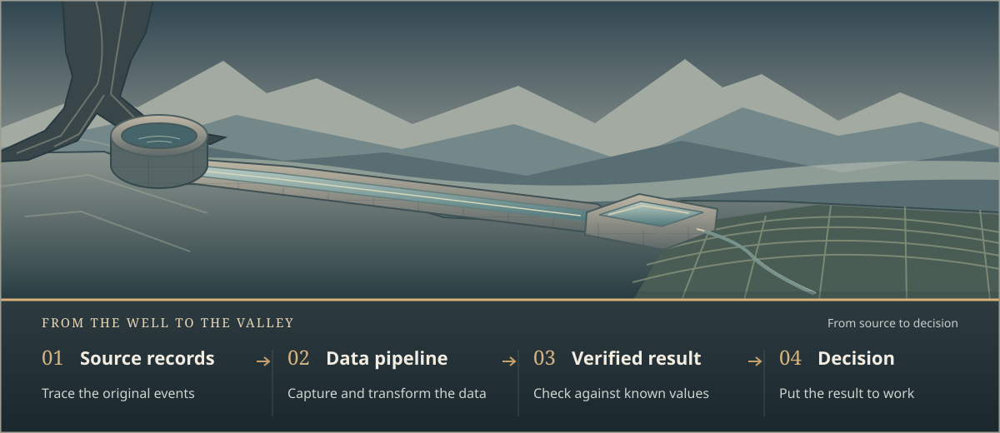

# Mimir

**Trace the change. Preserve the contract. Verify the result.**

Mimir gives Codex a disciplined way to work across application code, data pipelines, analysis, and ML. Use the same project guidance and skills in the Codex app, IDE extension, or CLI. Trace the affected paths, make a focused change, and inspect the evidence behind the result.


**[Get started](marketing/SETUP.md)** · [See the method](marketing/HOW_IT_WORKS.md) · [Try a task](marketing/USAGE.md)

## Why Mimir?

Ask Codex to change one chart in a Jupyter notebook and it can spend context reading cell metadata and saved outputs, then rewrite parts of the `.ipynb` JSON for a change that takes a few lines of Python. Bigger mistakes are easier to miss. A SQL query can run successfully while a join counts the same order twice. A churn model can score well in a holdout because it used a field that was filled in after the customer left.

Mimir gives Codex three ways to avoid that rework and catch those mistakes.

1. **Edit the source and generate the notebook.** Author and review Marimo `.py` files. Export Jupyter `.ipynb` through Marimo and use the manifest audit to catch stale or unregistered exports.
2. **Trace the records before changing the result.** Check what one row represents, which timestamp applies, and how many matches each join can return. Test a few orders with known totals and replay a duplicate event to verify that it counts once.
3. **Check the evidence behind the decision.** Evaluate a churn model using fields available at prediction time and compare it with a baseline. Show the metric’s denominator and data freshness so dashboard readers know what the result covers.

<picture>
  <source media="(max-width: 640px)" srcset="marketing/mimir-source-to-decision-mobile.svg">
  
</picture>

**Source records** → **Data pipeline** → **Verified result** → **Decision**

See how these checks work on a real task, from editing a notebook to tracing a dashboard number back to source records. [Try a task](marketing/USAGE.md#task-examples) · [Follow the captured-revenue example](marketing/HOW_IT_WORKS.md#example-captured-revenue-from-source-to-dashboard)

The engineering playbook explains how to define contracts, trace dependencies, and choose checks that fit your project. [Learn the engineering behind it](marketing/ENGINEERING_PLAYBOOK.md)

## Start in an existing project

Run the installer in **Linux Bash** or **WSL on Windows**. You need Bash 4.4+, Python 3.9+, Git, and `jq`. [Check the setup prerequisites](marketing/SETUP.md#prerequisites).

**1. Get Mimir outside your application repository.**

```bash
mkdir -p "$HOME/tools"
git clone https://github.com/febshhy/mimir-codex.git "$HOME/tools/mimir-codex"
```

**2. Preview changes to your clean Git project.**

```bash
cd /path/to/your-project
bash "$HOME/tools/mimir-codex/scripts/mimir" start --project . --integrate-agents
```

**3. Review the plan, apply it, and verify installation.**

```bash
bash "$HOME/tools/mimir-codex/scripts/mimir" start --project . --integrate-agents --apply
bash .mimir/install.sh --verify
```

Apply checks that the saved plan still matches the project. The installer preserves unrelated instructions and leaves your project's `docs/` directory alone.

Open the installed project in the Codex app or your IDE, or run `codex` from the project root. [Start Codex in your project](marketing/SETUP.md#start-codex).

For a [new project](marketing/SETUP.md#new-project), [global installation](marketing/SETUP.md#global-installation), or recovery, use the [setup guide](marketing/SETUP.md).

## Give Codex a first task

> Read `.mimir/AGENTS.md` and the relevant skills in `.agents/skills/`. Trace [business metric] from its source records to the report using real names. Identify the grain, timestamps, owners, and failure cases. Propose the smallest change and show how you would verify it against known records. Do not edit files yet.

For analyst, ingestion, dimensional modeling, ML, SQL tuning and notebook prompts, use [task examples](marketing/USAGE.md). The [book method index](marketing/BOOK_CONCEPTS.md) links the [chapter mapping](marketing/CHAPTER_TRACEABILITY.md) and [Advanced SQL chapter mapping](.agents/skills/advanced-sql/references/MACHADO_RUSSA_ESMERIZ_CHAPTER_MAP.md).

## Find the skills for your work

| Work | Skills to start with | What gets verified |
| --- | --- | --- |
| Data analyst | `$advanced-sql`, `$data-statistics`, `$data-storytelling` | Metric definitions, grain, bias, uncertainty and decision-ready charts. |
| Analytics engineer | `$data-dimensional-modeling`, `$advanced-sql` | Fact grain, history, keys, fanout, source reconciliation and semantic compatibility. |
| Data engineer | `$data-lifecycle`, `$data-operations` | Capture contracts, schema changes, retries, late data, replay and consumer freshness. |
| Data scientist | `$data-decision-science`, `$data-statistics`, `$marimo-notebooks` | Cutoffs/leakage, baselines, holdouts, reproducibility and decision value. |
| ML engineer | Those above plus `$software-design-thinking`, `$testing` | Serving contracts, fallbacks, monitoring and safe deployment/rollback. |
| Cross-team delivery | `$data-slicing`, `$graph-protocol` when warranted | One reviewable source-to-consumer slice, clear owners and acceptance evidence. |

Mimir ships **23 skills**. Choose skills by task. Use the [advanced application method](.agents/skills/software-design-thinking/references/ADVANCED-APPLICATION-DESIGN.md) for stateful services and the [Advanced SQL skill](.agents/skills/advanced-sql/SKILL.md) for data modeling, query semantics, and performance.

## The source-to-decision workflow

```ts
Business question or product behavior
  → actual source event / operational records (identity, time, version)
    → capture and data pipeline (freshness, replay, quality)
      → trusted model and metrics (grain, history, consumer contract)
        → query, analysis, feature or prediction (uncertainty, evaluation)
          → dashboard, API or action (meaning, access, fallback)
            → reconciliation, observation and safe recovery
```

Start with the smallest testable vertical slice. Assign an owner to each cross-team contract and reconcile results against known values. [See the data playbook.](marketing/DATA_PLAYBOOK.md)

## Project model defaults

| Session role | Configured model | Reasoning |
| --- | --- | --- |
| Coordinator | `gpt-6.2-sol` in `.codex/config.toml` | `high` |
| Independent review | `gpt-6.2-sol` in `.codex/agents/mimir_reviewer.toml` | `high` |

GPT-6.2 Sol coordinates work, decides material issues, independently reviews changes, and accepts delegated WRITE nodes through the schema-3 factory gate. GPT-6 Luna handles routine implementation and evidence collection. Start each subagent with fresh context (`fork_turns: none`) and a bounded A/E/R assignment. For each delegated WRITE, a different Luna agent gathers diff, source, and check evidence for Sol's review. Where the Codex desktop app offers it, choose **Approve for me** in the current chat.

The trusted Mimir clone sets `sandbox_mode = "workspace-write"`, `approval_policy = "on-request"`, and `approvals_reviewer = "auto_review"`. The installer retains model/routing files and agent profiles in installed projects but removes those three approval keys from generated project config. This is clone-scoped behavior, not a claim that Mimir's installer matches Heimdall verbatim. Review and trust a project and its hooks before enabling them.

The configured PreToolUse hook uses the documented current model to check that launches come from Sol and target the pinned `mimir_routine`/Luna or `mimir_reviewer`/Sol pair, with `fork_turns = "none"`. It routes controlled command/edit/write tools to the Luna model. PreToolUse does not document a caller profile field, so this hook does not identify the caller's agent profile. The reviewer profile disables supported shell, app, plugin, memory, and permission-request capabilities; these flags do not prove a live sandbox. Fixtures exercise the field checks but do not verify live Codex hook execution or enforcement.

```ts
Production (configured; live hook runtime unverified):
Codex PreToolUse event for Agent
  → `.codex/config.toml` PreToolUse command
    → `.codex/model-routing.py` main()
      → handle(event)
        → valid_spawn(tool_input, caller_model) for spawn tools
        → current-model check for command/edit/write tools
          → allow or deny

Tests:
`python3 -m unittest discover -s tests -p 'test_*.py'`
  → `tests/test_model_routing.py`
    → `.codex/model-routing.py` handle(event) / valid_spawn(tool_input, caller_model)
```

## Marimo-first notebook rule

Author notebooks as Marimo `.py` files and generate `.ipynb` deliverables with Marimo. For multiple input notebooks, compose a new Marimo `.py` using a reviewed manifest before exporting.

```bash
# Optional dependencies only for notebook work (Python compatible with marimo).
python -m pip install marimo nbformat
marimo edit notebooks/marimo/analysis.py
python scripts/mimir-notebooks export --source notebooks/marimo/analysis.py --output notebooks/generated/analysis.ipynb

# For multiple Marimo sources registered in notebooks/collection.json:
python scripts/mimir-notebooks bundle --manifest notebooks/collection.json
python scripts/mimir-notebooks verify --manifest notebooks/collection.json
python scripts/mimir-notebooks audit --root notebooks
```

Register each committed `.ipynb` in a manifest for the audit. Run the audit in CI and verify execution in the target Jupyter environment. See the [notebook skill](.agents/skills/marimo-notebooks/SKILL.md) and [composition contract](.agents/skills/marimo-notebooks/references/COMPOSITION_AND_EXPORT.md).

## Keep decisions and evidence in your control

Your project defines the expected behavior. Its tests, queries, and runtime checks provide the evidence. Use an isolated execution environment or a broker with scoped access for sensitive credentials. [Understand what counts as evidence](marketing/HOW_IT_WORKS.md#what-counts-as-evidence) · [Read the credential guidance](docs/security/CREDENTIAL_BOUNDARY.md)

## The name behind Mimir

Mimir takes its name from the figure associated with the well of wisdom in Norse mythology. The well in the illustration evokes the toolkit’s starting point. Find the source and understand what it can tell you before drawing a conclusion. [Mímir’s well in the Prose Edda](https://en.wikisource.org/wiki/Page%3AThe_Prose_Edda_%281916_translation_by_Arthur_Gilchrist_Brodeur%29.pdf/59)

[MIT license](LICENSE).
